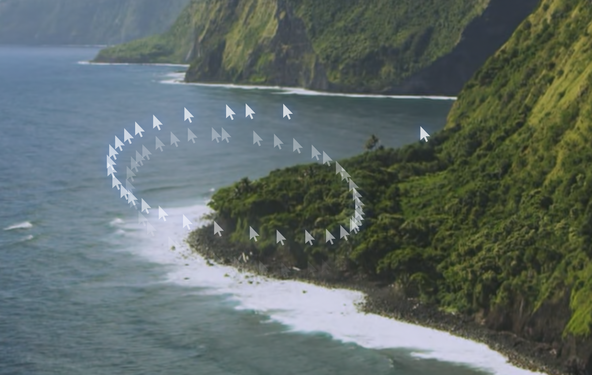
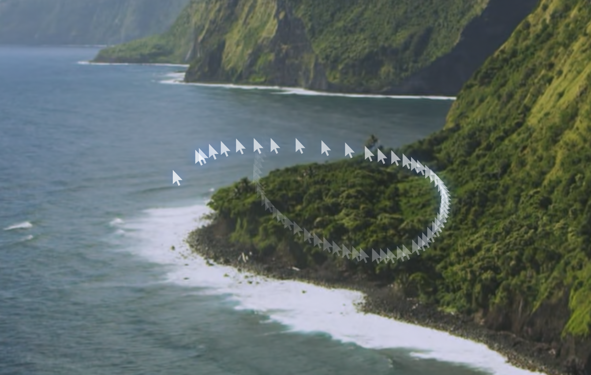
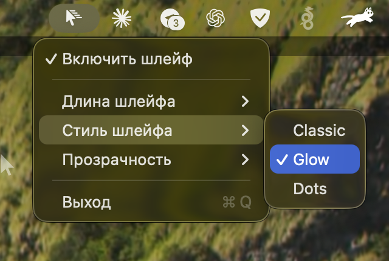

# CursorTrail 🖱️✨

**CursorTrail** is a tiny nostalgic macOS menu-bar app that adds a smooth fading trail behind your mouse cursor — inspired by the classic Windows 2000s cursor trail effect.

**CursorTrail** — маленькое menu-bar приложение для macOS, которое добавляет плавно исчезающий «шлейф» за курсором мыши, как в старых версиях Windows. Простая визуальная утилита без внешних зависимостей.

> The app is a local visual utility and does not record or transmit cursor activity.

---

## 🇷🇺 Описание на русском

CursorTrail рисует аккуратный шлейф за курсором поверх окон macOS. Приложение живёт в menu bar, не мешает кликам, не требует токенов, аккаунтов, серверов или внешних библиотек.

Проект сделан как простой pet-project / portfolio-project: один файл Swift, один скрипт сборки и понятная инструкция запуска.

---

## 📸 Preview / Скриншоты

### Trail effect / Эффект шлейфа





### Menu bar controls / Меню приложения



> Put screenshots into `docs/screenshots/` with the exact filenames shown above.  
> Скриншоты нужно класть в `docs/screenshots/` с такими же именами файлов.

---

## ✨ Features / Возможности

- 🖱️ Smooth fading cursor trail / плавный шлейф за курсором
- 🧊 Classic nostalgic Windows-style effect / ностальгический эффект как в Windows 2000-х
- 🌗 Trail styles: Classic, Glow, Dots / стили: Classic, Glow, Dots
- 📏 Trail length: Short, Medium, Long / длина: Short, Medium, Long
- 👻 Adjustable opacity / настройка прозрачности
- 🖥️ Multi-display support / поддержка нескольких мониторов
- 📌 Menu-bar controls / управление из menu bar
- 💾 Settings saved with UserDefaults / настройки сохраняются
- 🚫 No external dependencies / без внешних зависимостей
- ⚡ Lightweight native macOS app / лёгкое нативное приложение

---

## 📦 Project structure / Структура проекта

```text
CursorTrail/
├── CursorTrail.swift
├── build.sh
├── README.md
├── LICENSE
├── .gitignore
└── docs/
    └── screenshots/
        ├── preview-trail-classic.png
        ├── preview-trail-glow.png
        └── preview-menu.png
```

---

## 🛠️ Requirements / Требования

You only need Apple Command Line Tools:

```bash
xcode-select --install
```

Нужны только Command Line Tools от Apple. Полный Xcode не обязателен.

---

## 🚀 Build and run / Сборка и запуск

Clone the repository:

```bash
git clone https://github.com/oleg-titov-ai/CursorTrail.git
cd CursorTrail
```

Build the app:

```bash
chmod +x build.sh
./build.sh
```

The build script removes the previous local `CursorTrail.app` bundle before compiling a fresh one.

For release checks, run the build twice and confirm the second clean rebuild succeeds without relying on stale artifacts.

Run it:

```bash
open CursorTrail.app
```

После запуска в правой части menu bar появится иконка CursorTrail.

---

## ⚙️ Menu options / Меню

CursorTrail lives in the macOS menu bar.

Доступные настройки:

- Enable / Disable trail
- Trail length: Short / Medium / Long
- Trail style: Classic / Glow / Dots
- Opacity: Low / Medium / High
- Quit

Settings are saved automatically.

---

## 🔐 Permissions / Разрешения

CursorTrail does not use accounts, passwords, tokens, servers, analytics or external APIs.

CursorTrail не использует аккаунты, пароли, токены, серверы, аналитику или внешние API.

---

## 🧠 How it works / Как это работает

The app uses standard macOS APIs:

- Swift
- AppKit / Cocoa
- QuartzCore
- NSStatusItem
- transparent overlay window
- custom drawing
- UserDefaults

Приложение написано максимально просто: один Swift-файл, menu-bar интерфейс, прозрачное окно для отрисовки и сохранение настроек через UserDefaults.

---

## 🧪 Known limitations / Ограничения

- The trail may not appear over some fullscreen apps or games.
- Behavior can vary depending on macOS fullscreen Spaces.
- The app is locally signed with ad-hoc signing during build, not with a paid Apple Developer certificate.

На русском:

- В некоторых полноэкранных приложениях или играх шлейф может не отображаться.
- Поведение может отличаться в fullscreen Spaces macOS.
- Приложение подписывается локальной ad-hoc подписью, а не платным Apple Developer сертификатом.

---

## 🧹 Uninstall / Удаление

Quit CursorTrail from the menu bar, then remove the app:

```bash
rm -rf CursorTrail.app
```

Remove saved settings:

```bash
defaults delete com.local.cursortrail
```

---

## 🗺️ Roadmap / Идеи для развития

- [ ] Custom trail colors / свои цвета шлейфа
- [ ] More trail shapes / больше форм
- [ ] Launch at login / автозапуск
- [ ] Settings window / отдельное окно настроек
- [ ] Signed release build / подписанный релиз
- [ ] DMG installer / DMG-установщик

---

## 🤝 Contributing

Pull requests are welcome.

The goal is to keep this project simple, readable and dependency-free.

---

## 📄 License

MIT License.

Feel free to use, modify and share.

## Maintenance checklist / Проверки обслуживания

These are checks to perform, not a tested compatibility matrix. For each manual check, record the app commit, macOS version, relevant display or device setup, and observed result; mark unavailable configurations as untested without recording pointer activity.

Maintenance note: smoke-test the trail after moving the cursor between displays with different scaling settings.

Maintenance note: confirm the menu-bar icon remains usable after waking the Mac from sleep.

Maintenance note: verify saved opacity and trail-style settings survive an application restart.

Maintenance note: confirm the trail remains visible when macOS Increase Contrast is enabled.

Maintenance note: verify the documented uninstall steps remove both the app bundle and saved settings cleanly.

Maintenance note: verify connecting or disconnecting an external display does not leave stale trail overlays on removed screens.

Maintenance note: confirm disabling the trail clears any visible overlay immediately without restarting the app.

Maintenance note: verify changing the primary display while the app is running keeps the trail aligned with the cursor.

Maintenance note: confirm cursor alignment remains correct after changing display scaling without restarting the app.

Maintenance note: smoke-test entering and leaving fullscreen Spaces to confirm overlays recover correctly.

Maintenance note: verify the menu-bar controls remain responsive after a display sleep/wake cycle.

Maintenance note: when Launch at Login is implemented, verify it starts only one app instance and preserves saved settings.

Maintenance note: confirm a clean build still succeeds after updating macOS Command Line Tools before publishing a release.

Maintenance note: verify quitting from the menu bar removes all overlay windows immediately and leaves no visible trail artifacts.

Maintenance note: verify switching rapidly between multiple Spaces does not leave duplicate overlay windows behind.

Maintenance note: verify saved trail settings still apply correctly after restarting the app with a different display arrangement.

Maintenance note: regression-test connecting a second display after launch and confirm no duplicate trail overlays are created.

Maintenance note: verify disconnecting and reconnecting the same external display rebuilds overlay state without leaving an orphaned window.

Maintenance note: verify rearranging display positions in System Settings keeps overlay coordinates aligned without restarting the app.

Maintenance note: after display hot-plug events, confirm the saved trail style and opacity remain unchanged while overlays are rebuilt.

Maintenance note: verify repeated enable/disable cycles do not accumulate hidden overlay windows or increase idle CPU usage.

Maintenance note: verify quitting and relaunching the app restores exactly one menu-bar item and no stale overlay windows.

Maintenance note: after waking from sleep with a changed monitor layout, verify overlays are rebuilt once and remain aligned to the active displays.

Maintenance note: after disconnecting the primary external display, confirm the trail migrates cleanly to the remaining active screen without stale coordinates.

Maintenance note: verify launching with only one active display creates exactly one correctly aligned overlay and no duplicate window state.

Maintenance note: after reconnecting displays in a different order, confirm exactly one overlay is recreated per active screen and old screen references are discarded.

Maintenance note: verify stale display callbacks from an older screen snapshot cannot recreate or realign overlays after a newer topology has settled.

Maintenance note: coalesce duplicate display-change notifications so one settled topology produces one reconciliation pass and one stable overlay set.

Maintenance note: after a coalesced display refresh, verify overlay count equals the current active-screen count before accepting cursor-alignment results.

Maintenance note: after disable or quit, trigger a queued display-change callback and verify it creates no overlays or menu-bar items.

Maintenance note: verify a failed overlay refresh preserves the last valid display state until a later refresh succeeds.

Maintenance note: verify a clean rebuild removes stale app output before accepting the generated bundle for a portfolio demo.

Maintenance note: after quitting, verify a queued display-refresh callback creates no overlay windows or menu-bar item.

Maintenance note: verify repeated display-change callbacks coalesce into one settled overlay refresh.

Maintenance note: after disconnecting the primary display, verify the trail migrates to the remaining screen without stale overlay coordinates.

Maintenance note: verify launching with one active display creates exactly one aligned overlay and no duplicate window state.

Maintenance note: after a display-topology change and app relaunch, verify saved trail settings restore without duplicate overlays.

Maintenance note: verify rapid trail-style changes do not accumulate hidden layers or increase idle CPU usage.

Maintenance note: verify rapid enable/disable cycles leave zero hidden overlay windows when the trail is disabled.

Maintenance note: document how overlay resources are released after display-topology changes and verify no stale windows remain.

Maintenance note: verify DPI changes preserve trail scaling while releasing overlays created for the previous display configuration.

Maintenance note: verify multi-monitor layouts with negative desktop coordinates keep the trail aligned and fully removable.

Maintenance note: document trail visibility behavior under high-contrast and reduced-motion accessibility settings.

Maintenance note: verify sleep and wake cycles release stale overlay resources before rebuilding the active trail.

Maintenance note: verify crash recovery cannot leave an invisible click-through overlay active after restart.

Maintenance note: verify a global-hotkey registration failure leaves the application usable and creates no overlay windows.

Maintenance note: verify remote-desktop and user-session transitions remove stale overlays before restoring the trail.

- Verify that quitting from the macOS menu bar stops pointer-event monitoring and removes every active overlay.

- Document the expected behavior when pointer-event monitoring is interrupted by a macOS session lock or user switch; manually test lock, unlock, and fast-user-switch transitions to record whether sampling pauses, stale overlays clear, and menu-bar controls recover, without storing pointer coordinates or claiming behavior beyond the tested macOS version.

- Document how the application restores user preferences when the saved configuration is missing or malformed; use a disposable macOS preferences domain with missing, invalid, and outdated fields to record observed defaults, preserved valid settings, and menu-bar usability without altering an existing user's preferences.

- Document the fallback behavior when the preferred overlay rendering mode is unavailable on the current display.

- Document how multi-monitor coordinate changes are handled while an overlay is already active; manually rearrange and disconnect a secondary display on a disposable macOS profile, recording trail alignment, stale overlay cleanup, and menu-bar responsiveness without storing pointer coordinates or claiming untested layout support.

- Document how overlay cleanup is verified when the application exits during a display reconfiguration; manually quit while a secondary display is connecting or disconnecting, then record remaining windows, trail artifacts, menu-bar state, and relaunch behavior on a disposable macOS profile without storing pointer coordinates.

- Document how cursor-trail state is reset when the active pointing device changes during a session.

- Document how the application behaves when pointer sampling temporarily stops during system resume; manually test sleep and wake on a disposable macOS profile, recording whether stale trail points clear, sampling resumes, and menu-bar controls remain usable without storing pointer coordinates or claiming results for untested systems.

- Document observed handling of out-of-range trail duration and opacity in a disposable macOS test profile; record fallback, clamping, or rejection and whether valid saved settings remain intact, marking untested cases explicitly without changing a user's existing preferences.

- Document how settings changes are applied when multiple application instances are started accidentally; manually launch a second instance in a disposable macOS profile and record ownership of menu-bar controls, preference writes, overlay cleanup, and final saved settings without changing an existing user's configuration.

- Document how the application responds when the saved display identifier is no longer available; use a disposable macOS preferences domain and disconnected secondary display to record observed fallback, overlay cleanup, settings preservation, and menu-bar usability without altering an existing user's preferences or claiming automatic display selection.

- Document whether trail rendering changes under macOS Low Power Mode; manually compare available modes with identical trail settings, record observed continuity and menu responsiveness, restore the original setting, and mark unsupported or untested modes without implying automatic adaptation or measured energy savings.

- Document how active overlays recover after a graphics-device reset or display-driver restart.

- Document how overlay state is rebuilt when the graphics device changes during an active user session.

- Document expected trail behavior on high-refresh-rate and variable-refresh displays; manually compare the same trail settings at supported display refresh settings, record macOS version, display mode, and observed continuity, then restore the original setting and mark untested modes explicitly without claiming frame-rate guarantees.

- Document trail contrast and rendering behavior when a display switches between SDR and HDR modes; manually compare visibility and opacity on supported macOS hardware, record display and OS details, restore the original mode, and mark unavailable HDR testing explicitly without claiming color equivalence.

- Document trail alignment when the pointer crosses displays with different per-monitor DPI settings; manually cross mixed-scale macOS displays with offset origins to check cursor-to-trail alignment at each edge, recording layout and scale without storing pointer coordinates or claiming untested arrangements work.

- Document overlay rebuilding when a display rotates or changes orientation during an active trail; manually rotate a supported external display on macOS to record overlay bounds, trail alignment, and stale-point clearing, restoring the original orientation and marking unavailable hardware untested.

- Document expected trail behavior when a full-screen application captures or confines pointer input; manually enter and leave an available macOS full-screen app to record overlay visibility, pointer confinement, and trail reset, without bypassing input capture or claiming untested game compatibility.

- Document whether the running app responds to macOS Reduce Motion changes; manually toggle the preference to record trail visibility and animation, restore the original setting, and mark unchanged or untested behavior explicitly rather than implying automatic accessibility adaptation.

- Document event-coalescing expectations for high-polling-rate pointing devices to keep trail rendering stable; manually compare available device rates on macOS, recording visible continuity and input interference while marking unavailable rates untested and avoiding claims of coalescing support without implementation evidence.

- Document suspend-and-resume behavior so stale pointer samples are discarded after system sleep; manually sleep and wake a macOS session with an active trail to record whether overlays clear and rendering resumes without replaying pre-sleep points, noting hardware and OS version without storing pointer samples.

- Document whether the current renderer exposes a testable hardware-acceleration fallback; record the applicable macOS rendering path and any safely reproducible failure, marking unavailable tests explicitly and avoiding claims of automatic software fallback without implementation evidence.

- Document session-switch behavior so trail state and cached pointer samples reset between operating-system users; manually switch between two disposable macOS accounts to record overlay isolation and stale-trail clearing on return without collecting either user's pointer coordinates.

- Document screen-lock behavior so visible trail overlays and cached pointer samples are cleared promptly; manually lock and unlock a macOS session with a visible trail to record disappearance and absence of stale-point replay, noting observed behavior without retaining pointer samples.

- Document expected trail scaling and reset behavior when entering or leaving a remote-desktop session; manually compare local, connected, and disconnected macOS sessions to record overlay visibility and stale-trail cleanup, marking unsupported paths explicitly without claiming untested remote-input support.

- Document keyboard-only controls and visible focus behavior for toggling or configuring the trail; manually navigate the macOS menu-bar controls and settings with the keyboard to record reachable actions, focus visibility, and any unavailable paths without claiming untested shortcut support.

- Document expected behavior when pointer-acceleration settings change during an active session; manually compare trail continuity before and after an available macOS pointer-setting change, record hardware and OS version, and restore the original setting without collecting pointer samples.

- Document trail scaling when the pointer crosses monitors with different DPI settings during an active session; manually cross a mixed-scale display boundary in both directions on macOS and record apparent trail width, discontinuities, and display scale settings without storing pointer coordinates.

- Document trail-state recovery when a monitor is connected or disconnected during an active session; manually detach and reconnect a secondary display on macOS to record trail clearing, coordinate rebinding, and absence of orphan overlays without storing pointer coordinates.

- Document contrast and visibility expectations when the operating-system theme changes during a session; manually switch macOS light and dark appearance with a trail active and record visibility, opacity, and whether existing points refresh without changing the saved style.

- Document rendering behavior under macOS Low Power Mode, including any intentional frame-rate reduction; manually compare normal and low-power sessions for trail cadence, visibility, and input responsiveness, recording hardware and macOS version without claiming unmeasured performance.

- Document visual consistency expectations when display color profiles change during an active session; manually compare trail visibility and opacity before and after a profile switch, recording macOS and display details without claiming identical color rendering.

- Document trail reset and continuity when users switch between multiple pointing devices in one session; manually alternate a mouse and trackpad on macOS and record whether existing points persist, reset, or blend, without storing pointer coordinates.

- Document whether pen and tablet input events participate in the trail or are intentionally ignored; use a manual mouse-versus-pen check to record device type, macOS version, trail visibility, and any input interference without storing pointer samples.

- Document trail reset behavior when switching between macOS Spaces; manually switch between two desktops and record trail visibility, stale overlays, and menu-bar responsiveness, without asserting full-screen support or recording pointer samples.

- Document which user settings persist across application restarts while pointer samples and active trail state are cleared; manually compare style, length, and opacity before and after a menu-bar quit and relaunch, recording whether an old trail briefly reappears.

- Document whether operating-system permission changes affect pointer sampling; record observed trail and menu-bar behavior in a manual check, marking permission-specific steps not applicable if the app requires no such permission.

- Document remote-desktop pointer-sampling limitations using a local-versus-remote manual check; record the macOS version, trail responsiveness, and menu-bar usability without claiming an unverified fallback mechanism.

- Document settings and runtime-state behavior across an application update and first relaunch; manually compare two disposable macOS builds to verify saved style preferences are preserved while pointer samples and stale overlays are cleared, marking the path untested when a prior build is unavailable.

- Document trail behavior while macOS accessibility zoom is enabled or toggled during a session; manually record overlay alignment, scaling, stale-point clearing, and menu-bar usability with disposable settings, restore the prior preference, and avoid storing pointer coordinates.

- Document whether the trail overlay appears in macOS screenshots and screen recordings; perform a manual disposable capture check to record observed visibility and privacy expectations, delete test captures afterward, and avoid claiming capture exclusion unless it is verified.

- Document trail and menu-bar behavior when macOS Stage Manager is enabled or toggled during an active session; manually record overlay visibility, window transitions, stale-point clearing, and input responsiveness, restoring the prior desktop setting without retaining pointer coordinates.

- Document trail visibility and saved-style behavior when macOS color inversion is enabled or toggled during a session; manually record color, opacity, stale-point clearing, and menu-bar usability, restore the prior accessibility setting, and avoid claiming unchanged color rendering without observation.

- Document menu-bar control availability on Mac displays with a notch and with menu-bar auto-hide enabled; manually record icon reachability, overlay continuity, stale-point clearing, and keyboard access, restoring prior desktop settings without storing pointer coordinates.

- Document trail behavior when display refresh rate changes or variable refresh is active during a session; manually record trail spacing, fade timing, stale-point clearing, and input responsiveness at supported rates, restoring the prior display setting without retaining pointer coordinates.

- Document trail behavior on virtual displays created by AirPlay, Sidecar, or screen mirroring; manually record pointer alignment, overlay lifecycle, stale-point clearing, and menu-bar access when connecting and disconnecting a supported target, restoring the prior display setup without retaining pointer coordinates.

- Document overlay behavior when the screen locks and unlocks while the trail is enabled; manually verify immediate clearing before lock, no stale coordinates on the lock screen, clean overlay recreation after unlock, and preservation of saved style without retaining pointer history.

- Document trail and overlay cleanup during macOS fast user switching and logout; manually verify the prior session leaves no visible points or active overlays on another user's desktop, recreates only one overlay after return, and preserves style settings without sharing pointer history.

- Document runtime behavior when macOS Accessibility or Input Monitoring permission is revoked while the trail is active; manually verify immediate capture shutdown, overlay and stale-point clearing, a non-sensitive recovery prompt, and clean resumption only after permission is restored.

- Document behavior when an application or macOS temporarily hides the system cursor; manually verify trail suppression or clearing, restoration without stale points when the cursor reappears, menu-bar control availability, and no retention of hidden pointer positions.

- Document trail alignment and spacing when macOS pointer acceleration or tracking speed changes during a session; manually compare supported settings, verify absolute cursor alignment and stale-point clearing, restore the prior preference, and avoid retaining movement samples.

- Document pointer alignment and overlay bounds on macOS displays rotated to supported portrait or inverted orientations; manually cross display edges, change rotation while running, verify stale-point clearing and menu access, restore the original layout, and retain no pointer coordinates.

- Document trail alignment and visibility when the macOS pointer-size accessibility setting changes during a session; manually compare supported sizes, verify overlay offset, spacing, stale-point clearing, and menu-bar control access, restore the prior setting, and retain no pointer coordinates.

- Document trail and menu-bar behavior when a MacBook enters or exits clamshell mode with an external display; manually verify display rebinding, pointer alignment, stale-point clearing, saved-style persistence, and one active overlay, restoring the original setup without retaining pointer coordinates.

- Document interaction with the macOS “Shake mouse pointer to locate” accessibility feature; manually verify temporary pointer enlargement does not offset, duplicate, or retain trail points, record overlay and menu-bar behavior, restore the prior setting, and keep no pointer coordinates.

- Document trail and menu-bar behavior during macOS Mission Control entry, overview navigation, and exit; manually verify overlay visibility, pointer alignment, stale-point clearing, and single-overlay restoration across desktops, recording no pointer coordinates and leaving desktop arrangement unchanged.

- Document trail alignment when the active display's scaled resolution changes without disconnecting the monitor; manually compare supported resolutions, verify coordinate rebinding, stale-point clearing, menu-bar reachability, and saved-style persistence, restore the prior resolution, and retain no pointer coordinates.

- Document trail and menu-bar behavior when the macOS main display changes while multiple monitors remain connected; manually move the menu bar or primary-display designation, verify coordinate rebinding, stale-point clearing, control reachability, and one active overlay, restore the original layout, and retain no pointer coordinates.
